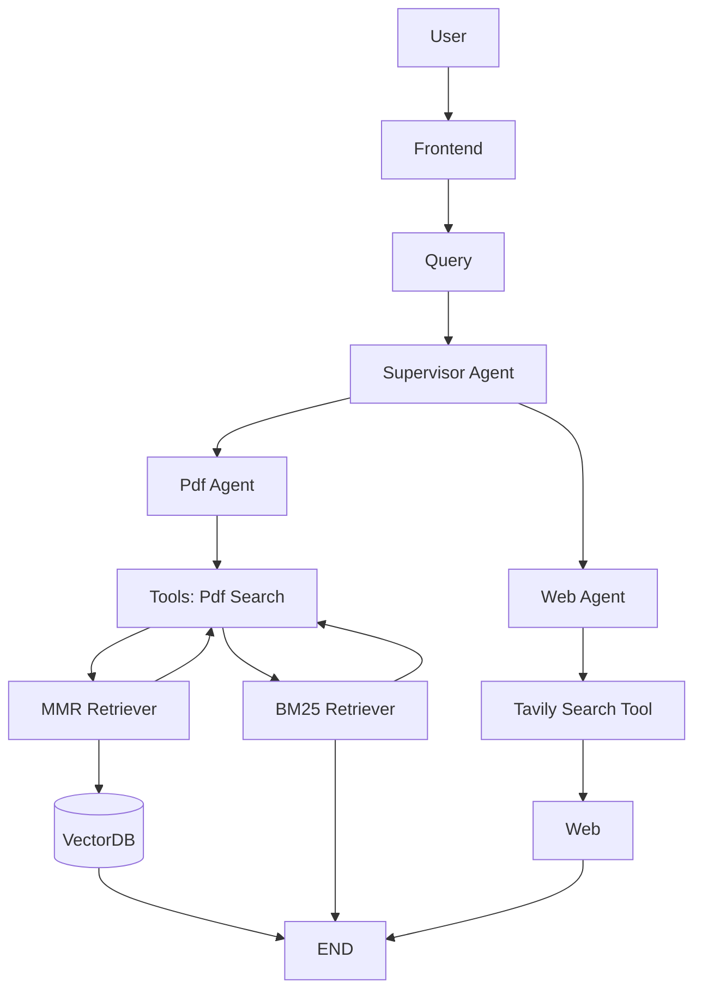

# 🤖 Multi-Agent RAG System

A multi-agent Retrieval-Augmented Generation (RAG) system that intelligently routes user queries between a **PDF Agent** and a **Web Agent**.

The system uses **LangGraph** for agent orchestration, **FAISS + BM25** for hybrid PDF retrieval, **Tavily** for web search, and a locally hosted **Qwen3:4B** model through Ollama.

---

## 🚀 Features

- 📄 **PDF Question Answering**
  - Upload a PDF and ask questions about its content.
  - Documents are split into smaller chunks for efficient retrieval.
  - Uses semantic and keyword-based retrieval.

- 🔎 **Hybrid Retrieval**
  - **FAISS** for semantic/vector similarity search.
  - **BM25** for keyword-based retrieval.
  - Combines both retrieval approaches to improve retrieval quality.

- 🌐 **Web Search Agent**
  - Uses Tavily to search the internet.
  - Handles queries requiring current or external information.

- 🧠 **Supervisor Agent**
  - Analyzes the user's query.
  - Determines whether the PDF Agent or Web Agent should handle the request.
  - Can orchestrate multiple agents in a ReAct-style workflow.

- 🔄 **LangGraph Workflow**
  - Manages communication between agents.
  - Maintains shared state and message history.
  - Supports agent → supervisor → agent loops.

- 🖥️ **Streamlit Interface**
  - Upload PDFs through a web interface.
  - Ask questions through a chat interface.
  - Displays which agent handled the query.

- 🏠 **Local LLM**
  - Uses Qwen3:4B through Ollama.
  - Main LLM inference runs locally.

---

## ⚙️ Setup

The commands below are for Windows PowerShell.

### 1. Create and activate the virtual environment

```powershell
python -m venv .venv
.\.venv\Scripts\Activate.ps1
pip install -r requirements.txt
```

If the virtual environment already exists, activate it and install any missing
dependencies with the same `pip install` command.

### 2. Configure API keys

The current configuration uses Groq for the chat model and Tavily for web
search. Create a `.env` file in the project root:

```env
GROQ_API_KEY=your-groq-api-key
TAVILY_API_KEY=your-tavily-api-key
```

Do not commit `.env` or expose these keys publicly.

---

## ▶️ Run the application

There are two available interfaces.

### Custom frontend

Start the FastAPI backend in one PowerShell terminal:

```powershell
.\.venv\Scripts\python.exe -m uvicorn api:app --reload --port 8000
```

Check that the backend is running at
[`http://localhost:8000/health`](http://localhost:8000/health).

Start the frontend in a second PowerShell terminal:

```powershell
.\.venv\Scripts\python.exe -m http.server 5500 --directory frontend
```

Open [`http://localhost:5500/chat.html`](http://localhost:5500/chat.html),
upload a PDF, and start chatting.

### Streamlit interface

To run the original Streamlit interface:

```powershell
.\.venv\Scripts\python.exe -m streamlit run app.py
```

Open [`http://localhost:8501`](http://localhost:8501) in your browser.

---

## 🏗️ Architecture


